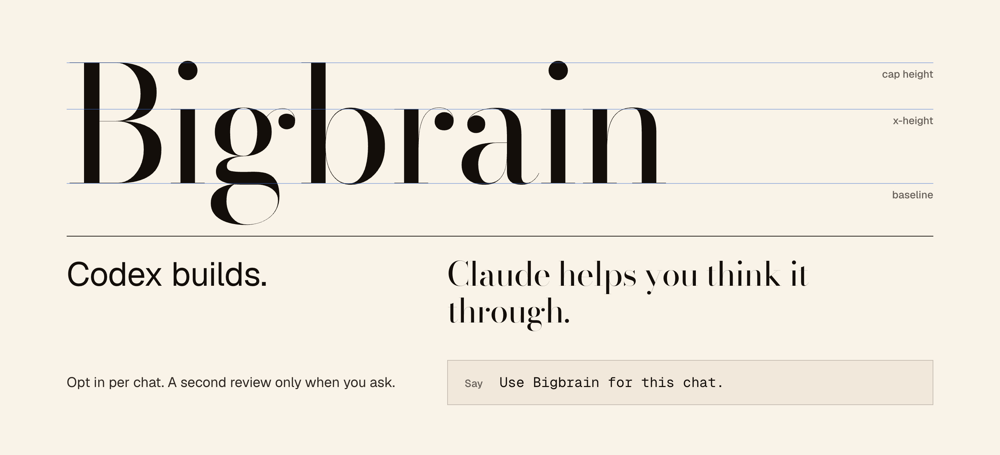
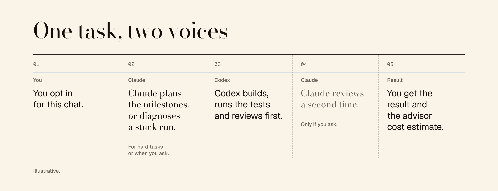

<div align="center">
  <h1>Bigbrain</h1>
  <p><a href="README.md">English</a> · <a href="README.zh-CN.md">简体中文</a> · <a href="README.ja.md">日本語</a> · <a href="README.ko.md">한국어</a> · <a href="README.es.md">Español</a> · <a href="README.fr.md">Français</a> · <strong>Deutsch</strong> · <a href="README.pt-BR.md">Português (Brasil)</a></p>
  <p>
    <a href="https://github.com/kangchainx/bigbrain-skill/actions/workflows/tests.yml"></a>
    <a href="LICENSE"></a>
    <a href="https://www.python.org/"></a>
  </p>
</div>

Hole Claude zur Planung und Fehlerdiagnose in deinen Codex-Chat. Codex schreibt den Code, führt Prüfungen aus und übernimmt das erste Review. Du entscheidest, wann du eine zweite Meinung möchtest.



**Standardmäßig aus, pro Chat ausdrücklich aktivierbar.** Danach können schwierige Aufgaben Claude zur Planung oder Diagnose hinzuziehen. **Ein zweites Code-Review durch Claude ist optional und erfordert eine ausdrückliche Anfrage.**

## Wann Bigbrain hilft

| Du brauchst… | Bigbrain hilft mit… |
|---|---|
| Einen Plan vor einer aufwendigen Änderung | Meilensteinen mit überprüfbaren Abnahmekriterien statt unklarer Anforderungen. |
| Einen Ausweg nach wiederholten Fehlschlägen | Einer Diagnose durch Claude anhand der bisherigen Versuche und Belege. |
| Kontinuität und Kontrolle | Einer Claude-Sitzung pro Aufgabe, lokalen Erkenntnissen und sichtbaren Kostenschätzungen für den Berater. |

## Erste Schritte

Du brauchst Codex, Python 3 und eine angemeldete Claude Code CLI mit Unterstützung für `--safe-mode` (getestet mit 2.1.310). Bigbrain selbst verwendet nur die Python-Standardbibliothek. Führe die folgenden Befehle im geklonten Repository aus.

```bash
git clone https://github.com/kangchainx/bigbrain-skill.git
cd bigbrain-skill
./install.sh --no-setup
python3 scripts/bigbrain_cli.py setup --claude-code
python3 scripts/check_config.py --no-call --json
```

Falls du noch nicht angemeldet bist, führe zuerst `claude auth login` aus. Das Setup wählt das Backend. Die Prüfung ohne Modellaufruf bestätigt nur die Anmeldung; der erste echte Berateraufruf prüft Modellzugriff und Generierung.

Schreibe danach im Codex-Chat:

> Aktiviere Bigbrain für diesen Chat. Hilf mir, diese Änderung vor der Umsetzung zu planen.

Zum Beenden sage **„Deaktiviere Bigbrain für diesen Chat.“** Beim Fortsetzen desselben Chats bleibt der Zustand erhalten. Neue und abgezweigte Chats beginnen deaktiviert. Die Installation allein aktiviert den Skill nicht.

<details>
<summary>Weitere Installationsmöglichkeiten</summary>

Wähle mit der skills CLI Codex als Ziel. Bitte Codex anschließend, Bigbrain mit Claude Code einzurichten. Dabei muss der tatsächliche Installationspfad des Skills verwendet werden, ohne einen lokalen Repository-Klon vorauszusetzen.

```bash
npx skills add kangchainx/bigbrain-skill
```

Im Repository installiert `./install.sh --copy` eine Kopie statt eines symbolischen Links. `--claude` installiert zusätzlich für Claude Code, `--dir PATH` legt das Ziel fest. Standard: `${CODEX_HOME:-$HOME/.codex}/skills/bigbrain`. Bei einer Link-Installation muss das Repository erhalten bleiben.

</details>

## Eine Aufgabe, klare Rollen



<p align="center"><a href="docs/assets/demo.en.mp4"></a></p>

[24 Sekunden Dialog mit Musik ansehen (MP4). Szenische Demonstration.](docs/assets/demo.en.mp4)

*Schematische Darstellung der Rollen und Abläufe*

1. **Du aktivierst Bigbrain.** Komplexität allein aktiviert keinen ausgeschalteten Chat.
2. **Claude berät bei Bedarf.** In einem aktivierten Chat löst ein Planungswert über `0.6` eine Beratung aus; eine ausdrückliche Anfrage kann sie ebenfalls auslösen. Einfache Arbeit bleibt bei Codex.
3. **Codex setzt um und prüft zuerst.** Es bearbeitet Dateien, führt Prüfungen aus und übernimmt das erste Code-Review. Ein zweites Review durch Claude braucht eine ausdrückliche Anfrage.
4. **Belege bleiben erhalten.** Feedback kann eine Aufgabe für Diagnose und neue Prüfergebnisse wieder öffnen. Berateraufrufe erfassen Tokens und geschätzte Kosten.

## Backend für den Berater wählen

|  | Claude Code · empfohlen | Messages API · Alternative |
|---|---|---|
| Authentifizierung | Eigene Anmeldung von Claude Code | API-Schlüssel des Anbieters |
| Modell | `BIGBRAIN_CLAUDE_MODEL` (Standard: `opus`) | `BIGBRAIN_MODEL` (Standard: `claude-opus-5-5`) |
| Kontext | Persistente Sitzung je Aufgabe; nur Read/Glob/Grep | Von Codex bereitgestellter Kontext |
| Kosten | Schätzung von Claude Code | Gemeldete Nutzung × konfigurierte Preise |

Bestehende Aufgaben behalten Backend und Modell. Ältere Konfigurationen ohne Backend verwenden aus Kompatibilitätsgründen weiterhin `api`. **Es gibt keinen stillen Backend-Wechsel.** Der Modellzugriff hängt vom Konto oder Endpunkt ab.

<details>
<summary>Messages-API-Anbieter konfigurieren</summary>

Öffne im Repository das lokale Formular mit dem folgenden Befehl. Trage dort HTTPS-Endpunkt, API-Schlüssel und Modell ein, niemals den Schlüssel im Chat. Das Formular lädt die Modellliste und speichert erst nach einer erfolgreichen echten Generierung.

```bash
python3 scripts/bigbrain_cli.py setup --web
```

Streaming und Wiederholungen bei vorübergehenden Fehlern gelten nur für das API-Backend. Der Anbieter muss Modell und thinking/effort-Parameter unterstützen; JSON im Anthropic-Format allein genügt nicht. `BIGBRAIN_BASE_URL` endet nicht mit `/v1`. Umgebungsvariablen haben Vorrang vor gespeicherten Einstellungen. Siehe [Konfiguration](references/config.md).

</details>

## Deine Sitzung, deine Kontrolle

- **Getrennte Zuständigkeiten.** Der Claude-Code-Berater darf nur Read/Glob/Grep verwenden und startet mit `--safe-mode`, leerer strikter MCP-Konfiguration und deaktivierten Slash-Befehlen. Codex bearbeitet Dateien und führt Tests aus.
- **Lokaler Zustand.** Erkenntnisse liegen in `~/.bigbrain/experience/`, Aufgabenprotokolle im Arbeitsverzeichnis unter `.bigbrain/`. Relevanter Kontext und Bilder werden an den gewählten Berater gesendet. Lokale Speicherung bedeutet keine Offline-Inferenz.
- **Keine globalen Anweisungen ändern.** Bigbrain verändert weder `AGENTS.md` noch `CLAUDE.md` oder globale Codex/Claude-Konfigurationen. Das Setup schreibt nur die eigene Konfiguration.
- **Sichtbare Nutzung.** Kosten sind Schätzungen, keine Rechnung und kein Nachweis einer Abo-Abbuchung. Fehlende Nutzungsdaten werden gekennzeichnet. Einsparungsvergleiche schätzen auch die Tokens des ausführenden Modells und sind kein Benchmark.

## Manuelle Bedienung

Normalerweise steuert Codex den Ablauf. Diese Befehle zeigen im Repository den Chat-Zustand oder eine bestehende Aufgabe an, ohne den Berater aufzurufen:

```bash
python3 scripts/bigbrain_cli.py mode status
python3 scripts/bigbrain_cli.py status --session .bigbrain/my-task
```

<details>
<summary>Erweitert: Meilensteinschleife des Beraters</summary>

Nach ausdrücklicher Aktivierung bleibt jede Aufgabe im selben Sitzungsverzeichnis. Diese Befehle rufen den Berater auf. `m1.md` muss echte Ergebnisse und Prüfbelege enthalten.

```bash
python3 scripts/bigbrain_cli.py mode on
python3 scripts/bigbrain_cli.py lessons list --limit 10
python3 scripts/bigbrain_cli.py start --task "..." --user-request --effort medium --session .bigbrain/my-task
python3 scripts/bigbrain_cli.py report --session .bigbrain/my-task --result-file m1.md
python3 scripts/bigbrain_cli.py feedback --session .bigbrain/my-task --reason "..."
```

Die Beraterschleife akzeptiert `done` erst, wenn alle Abnahmekriterien als erfüllt markiert sind. Das macht eine Claude-Freigabe für ein reines Codex-Code-Review nicht verpflichtend. Standard: 8 Runden, Denkaufwand `medium`; auch `high` und `xhigh` sind verfügbar. Am Ende folgt normalerweise ein Retrospektivaufruf. Exit-Codes: `0` weiter oder `DONE`; `10` blockiert; `11` Runden ausgeschöpft; `12` JSON auch nach Reparatur ungültig; `2`–`6` Konfigurations- oder Anbieterfehler.

</details>

<details>
<summary>Optional: Hooks des Codex-Plugins</summary>

Das Repository enthält einen lokalen Plugin-Marktplatz. Registriere ihn mit diesen Befehlen und prüfe und bestätige die Hooks in Codex. Deaktiviere den eigenständigen Skill-Eintrag, um doppelte Erkennung zu vermeiden. Der Skill-Installer registriert oder bestätigt keine Hooks.

```bash
codex plugin marketplace add /absolute/path/to/bigbrain-skill
codex plugin add bigbrain@bigbrain-local
```

SessionStart und UserPromptSubmit erinnern nur in aktivierten Chats an die Regeln. Hooks rufen keine Modelle auf und können nicht alle Gesprächsregeln erzwingen. Siehe [Zusammenarbeit](references/collaboration.md) und [Sitzungswiederherstellung](references/native-sessions.md).

</details>

## Praktische Fragen

**Wird Claude für jede Aufgabe aufgerufen?**

Nein. Deaktiviert werden keine neuen Berateraufrufe des Workflows gestartet. Auch aktiviert kann Codex einfache Aufgaben allein lösen. Deaktivieren unterbricht keine laufende Anfrage.

**Kann ich es ohne Modellaufruf ausprobieren?**

Führe im Repository `bash examples/minimal/run.sh` aus. Vorgefertigte Antworten zeigen den Ablauf, kein echtes Review.

**Wie prüfe ich den Code?**

Mit `bash tests/run_tests.sh`. Die Tests verwenden temporäre Verzeichnisse und lokale Mocks, keine echten Anbieteraufrufe.

**Wie deinstalliere ich Bigbrain?**

Führe im Repository `./install.sh --uninstall` aus. Erkenntnisse bleiben erhalten. Ergänze `--purge` nur, wenn du auch den benutzerweiten Bigbrain-Speicher löschen möchtest.

## Weitere Informationen

[Konfiguration und Backends](references/config.md) · [Eskalationsregeln](references/triggers.md) · [Sitzungen und Wiederherstellung](references/native-sessions.md) · [Lokale Erkenntnisse](references/experience.md) · [Offline-Kostenprüfung](references/session-audit.md) · [Mitwirken](CONTRIBUTING.md)

---

Erstellt von **Chris Kang** ([@kangchainx](https://github.com/kangchainx)).

[MIT](LICENSE) · © 2026 Chris Kang. Wenn du auf Bigbrain aufbaust, freuen wir uns über einen Link zu diesem Repository.
