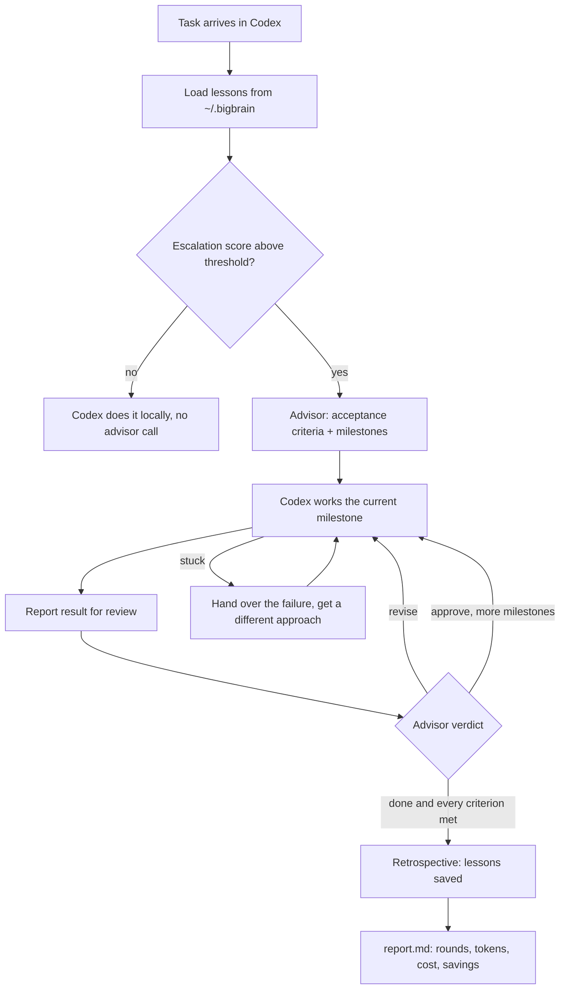

# Bigbrain

**Claude helps plan; Codex executes and reviews, with optional Claude second review.** An agent skill that lets Codex do the work and call in an
Opus advisor only when the task is hard enough to need one — then keeps going, milestone by
milestone, until the acceptance criteria are actually met.

[](LICENSE)
[](https://github.com/kangchainx/bigbrain-skill/actions/workflows/tests.yml)
[](#faq)

English · [简体中文](README.zh-CN.md)

## Why

A strong model is most valuable for **judgement**: clarifying a fuzzy spec, choosing an
approach, splitting work into checkable steps, and spotting a test that proves less than it
claims. Most of the token volume in a coding session is something else: reading files, writing
code, running tests.

Bigbrain splits those two jobs. Codex stays the executor and does the bulk of the work. When a
task scores as complex or risky, it escalates to an advisor model over any Anthropic-compatible
Messages API, or use the Claude Code CLI backend. The advisor plans in milestones with acceptance criteria, reviews Codex's real
output, and keeps pushing the task forward. Simple tasks never leave Codex.

## How it works



1. **Score.** `score` turns files changed, ambiguity, consecutive failures, risk tags and an
   explicit user request into one 0–1 number and compares it to a threshold (default `0.6`).
2. **Plan.** Round 1 returns global acceptance criteria and a few milestones, each with its own
   steps and criteria.
3. **Loop.** Codex works one milestone at a time and reports it. The advisor approves, asks
   for a revision with specific issues, or rejects.
4. **Finish.** The loop ends only when the advisor says `done` **and** marks every criterion
   met. Then a retrospective saves lessons, and a report records what the run cost.

## Features

- **Computed escalation.** A weighted score against a configurable threshold, not a gut call.
- **Task-based reasoning effort.** The executor chooses medium by default, high for
  difficult work, or xhigh for the hardest problems. `--effort` sets the CLI/API request
  explicitly and persists across rounds; xhigh is the ceiling, with no max option.
- **Milestones with a real finish line.** A `done` that cannot say which criteria passed keeps
  looping.
- **`stuck` re-escalation.** Hand over the failure and the attempts so far, and get a different
  approach rather than a restatement.
- **Automatic retrospective.** When a session ends (done, blocked, or out of rounds), the
  advisor reviews the process and returns lessons.
- **Lessons that carry across sessions.** Stored at user level, injected into future advisor
  requests, merged and pruned by confidence × recency.
- **Usage and savings report.** Advisor tokens summed from the API's `usage` fields, a cost
  estimate at configurable prices, and the estimated saving versus sending everything to the
  premium model. Saved internally to `report.md` and `report.json`; displayed only
  when requested with `finish`. Every task ends with a compact advisor cost estimate,
  including recorded repair and retrospective calls. Missing usage is flagged.
  The CLI backend uses Claude Code’s reported estimate; it is not proof of an actual
  subscription charge. The API backend uses configured token prices.
- **Visible collaboration.** Role-labelled chat updates show Claude’s plan and review
  reasons, Codex’s implementation/checks, and Claude’s final acceptance. Only real
  results are relayed, never private chain-of-thought or invented dialogue.
- **Immediate user feedback.** `feedback` reopens even a completed task, asks Claude
  to diagnose before edits, invalidates old acceptance evidence and requires fresh review.
- **Streaming with retries.** SSE by default so proxies don't time out on long thinking turns;
  transient errors (429/5xx/524, dropped streams) are retried with backoff.
- **Python 3 standard library only.** No pip installs, no dependencies.

## How it compares

These are architectural differences, not a ranking. A plain Codex session is simpler and has
no second model to configure; a Claude-led setup suits people who want Claude in charge of the
session.

| | Plain Codex | Claude-led, e.g. codexmcp | Bigbrain |
|---|---|---|---|
| Who drives the session | Codex | Claude; Codex is called as an MCP tool | Codex |
| Where the stronger model is used | — (one model) | Claude runs the whole session | Only on escalated tasks: planning and reviews |
| When the second model is consulted | — | When Claude decides to call the Codex tool | When the escalation score crosses a configurable threshold |
| What "done" means | The agent's own judgement | The driving agent's judgement | Advisor says `done` **and** every acceptance criterion is marked met |
| Token / cost report with savings estimate | No savings estimate (one model) | See its docs | Yes, per run |
| Lessons across sessions | Via your own `AGENTS.md`, if you keep one | See its docs | User-level store in `~/.bigbrain`, never an `AGENTS.md` |
| Extra requirements | — | An MCP host plus Codex | Claude Code login or an Anthropic-compatible API key |

For a sourced comparison with sendbird/cc-plugin-codex, openai/codex-plugin-cc and
pal-mcp-server, see [`references/comparison-sources.md`](references/comparison-sources.md).

## Install

With the [skills](https://github.com/vercel-labs/skills) CLI:

```bash
npx skills add kangchainx/bigbrain-skill
```

From a checkout:

```bash
git clone https://github.com/kangchainx/bigbrain-skill.git
cd bigbrain-skill
./install.sh                       # ${CODEX_HOME:-$HOME/.codex}/skills/bigbrain only
./install.sh --claude              # also install into ~/.claude/skills/bigbrain
./install.sh --copy                # copy instead of symlink
./install.sh --no-setup            # don't offer the setup wizard afterwards
./install.sh --uninstall           # remove the skill, keep your lessons
./install.sh --uninstall --purge   # also remove ~/.bigbrain
```

One-liner, no checkout:

```bash
curl -fsSL https://raw.githubusercontent.com/kangchainx/bigbrain-skill/main/install.sh \
  | BIGBRAIN_SRC=https://github.com/kangchainx/bigbrain-skill/archive/refs/heads/main.tar.gz bash
```

`tests/`, `docs/`, `.github/`, `.bigbrain/` and any lesson store are left out when the skill
is copied into place.

The installer does not create a second entry in `~/.agents/skills`, since Codex
also scans that directory. Use `--dir PATH` to choose a different destination.

## Configure

Recommended for independent repository review:

```bash
claude auth login  # if not already logged in
python3 scripts/bigbrain_cli.py setup --claude-code
python3 scripts/check_config.py --no-call --json
```

Requires a recent Claude Code CLI supporting `--safe-mode` (tested with 2.1.310).
The advisor has Read/Glob/Grep only; Codex edits and runs tests. Bigbrain binds each task to a persistent native session and sends delta inputs
using its explicit ID. See [session management and recovery](references/native-sessions.md). Existing tasks
keep their backend/model and working directory. `BIGBRAIN_CLAUDE_MODEL` defaults
to the CLI alias `opus`; `BIGBRAIN_MODEL` remains the legacy API model.
Setup checks login, not generation; a real advisor call verifies model access.
Claude CLI authentication stays with Claude Code. Existing API credentials are
preserved, but are not forwarded by Bigbrain to the CLI. CLI environment auth
variables still follow Claude Code's own precedence. There is no silent fallback.

For backwards compatibility, configurations without a backend remain `api`.
Set `BIGBRAIN_BACKEND=api` to explicitly use the legacy API backend.

Any Anthropic-compatible Messages API works: Anthropic itself or a relay.

In Codex, ask Bigbrain to configure the API. The skill opens its local form in
the in-app browser, one step at a time: HTTPS API URL, a hidden password field for
the key, then model selection. Claude Opus 5.5 is recommended only when the endpoint
lists its exact id; the rest remain under **Other models**. A tiny real request
must pass before configuration is saved. Keys never need to enter the chat.

```bash
python3 ~/.codex/skills/bigbrain/scripts/bigbrain_cli.py setup --web
```

Open the printed URL and leave the process running while filling the form. It exits
after save/cancel or 15 minutes. See [configuration](references/config.md#configuration-in-codex).
For a terminal wizard with hidden key input, omit `--web`. Only
`~/.bigbrain/config.json` is written, mode `600` in a `700` directory; existing
Codex/Claude configuration is never modified.

Or set the environment yourself:

```bash
export BIGBRAIN_BASE_URL=https://api.anthropic.com   # no trailing /v1
export BIGBRAIN_API_KEY=sk-...
python3 scripts/check_config.py                       # must print OK before Bigbrain escalates
```

The check is judged, not just received: an endpoint that answers a one-word ping with a long
paragraph is reported as unusable. `check_config.py --list-models` shows the model ids your
endpoint serves.

| Variable | Default | Meaning |
|---|---|---|
| `BIGBRAIN_MODEL` | `claude-opus-5-5` | Advisor model id (spelling is provider-specific) |
| `BIGBRAIN_THRESHOLD` | `0.6` | Escalate when the score is above this |
| `BIGBRAIN_MAX_ROUNDS` | `8` | Round budget per session |
| `BIGBRAIN_TIMEOUT` | `300` | Per-read socket timeout, seconds |
| `BIGBRAIN_LESSON_INJECT` | `8` | Lessons injected into each advisor request |
| `BIGBRAIN_PRICE_IN` / `_OUT` | `15` / `75` | Advisor price, USD per million tokens |
| `BIGBRAIN_EXECUTOR_PRICE_IN` / `_OUT` | `1.25` / `10` | Executor price, for the savings estimate |
| `BIGBRAIN_HOME` | `~/.bigbrain` | User-level config and lesson store |

Settings can also live in `~/.bigbrain/config.json` (what the wizard writes) or
`~/.config/bigbrain/config.env`; environment variables always win over both. `ANTHROPIC_*`
variables are ignored at run time unless you opt in with `BIGBRAIN_USE_ANTHROPIC_ENV=1` (the
wizard can copy them into `config.json` if you accept them). Full reference:
[`references/config.md`](references/config.md).

## Safety guarantees

- **Never touches `AGENTS.md`, `CLAUDE.md`, or global Codex/Claude config.** Every write goes
  through a guard ([`scripts/bigbrain/agents_md.py`](scripts/bigbrain/agents_md.py)) that refuses
  those paths, and the test suite asserts no `AGENTS.md` is created or modified anywhere under a
  temporary home after a full install/run/uninstall cycle.
- **Lessons stay local** in `${BIGBRAIN_HOME:-~/.bigbrain}/experience/`. A store inside the skill
  package or inside a git repository is refused, so lessons can't be committed by accident.
  Details: [`references/experience.md`](references/experience.md).
- **The installer only places the skill** (and, if you say yes on a terminal, runs the setup
  wizard, which writes only `~/.bigbrain/config.json`). `--uninstall` keeps your lessons; only
  `--purge` removes them.
- **Your key is never printed** — only masked as `****` plus its last 4 characters.
- **Session transcripts stay in your workspace** under `.bigbrain/`, which is git-ignored.

## Savings: an example from one real run

> Opus advisor cost **$0.85**, **2 rounds**, an estimated **~58.6% saved** compared with
> sending the whole run's token volume to the premium model.

This is one run, not a benchmark. The saving depends on the task, your prices and how much work
the executor does between reviews. The executor's own token volume never reaches the advisor
API, so the report estimates it and says so. Treat the figure as a sizing estimate, not an
invoice.

## Usage

The skill instructions in [`SKILL.md`](SKILL.md) tell the agent what to run. By hand:

```bash
python3 scripts/bigbrain_cli.py lessons list --limit 10           # always first
python3 scripts/bigbrain_cli.py score --files-estimated 5 --ambiguity 0.7 --high-risk migration
python3 scripts/bigbrain_cli.py start  --task "..." --session .bigbrain/s1
python3 scripts/bigbrain_cli.py report --session .bigbrain/s1 --result-file m1.md
python3 scripts/bigbrain_cli.py stuck  --session .bigbrain/s1 --reason "..." --attempts 2
python3 scripts/bigbrain_cli.py status --session .bigbrain/s1
```

Exit codes drive the loop: `0` continue · `0` + `DONE` finished · `10` blocked · `11` round
budget exhausted · `12` invalid advisor JSON after one repair retry · `2`–`6`
config/network/auth/model/HTTP failures.

A complete worked example, runnable offline with no API key:
[`examples/minimal/`](examples/minimal/README.md).

## FAQ

**Does it need Codex?**
It is written for Codex as the executor, and the installer targets
`${CODEX_HOME:-~/.codex}/skills`. `./install.sh --claude` also installs it for Claude Code.

**Which providers work?**
Anything that serves `POST /v1/messages` in Anthropic's format. Each request sends both
`x-api-key` and `Authorization: Bearer`, since relays differ in which one they check.

**Will it call the advisor on every task?**
No. Tasks that score at or below the threshold stay local with no advisor call. Raise
`BIGBRAIN_THRESHOLD` to escalate less often.

**What stops it looping forever?**
`BIGBRAIN_MAX_ROUNDS` (default 8). Running out of rounds exits with code `11`, and the
retrospective and report still run.

**Can I try it without an API key?**
Yes: `bash examples/minimal/run.sh`. It uses scripted replies, so treat it as a tour of the
mechanics, not a real review.

**Does it install anything with pip?**
No. It is Python 3 standard library only.

**How do I run the tests?**
`bash tests/run_tests.sh`. It runs end to end under a temporary `HOME` against a local mock
server. No real API is contacted.

## Contributing

Issues and pull requests are welcome; see [CONTRIBUTING.md](CONTRIBUTING.md).

## Author

Created by **Chris Kang** ([@kangchainx](https://github.com/kangchainx)), also known as
"Chris不上班".

If you build on this project, please credit it with a link back to
[kangchainx/bigbrain-skill](https://github.com/kangchainx/bigbrain-skill). Thank you!

## License

[MIT](LICENSE) © 2026 Chris Kang (kangchainx)

## Optional Codex plugin hooks

This repository also contains `.codex-plugin/plugin.json` and `hooks/hooks.json`.
A repo marketplace is provided at `.agents/plugins/marketplace.json`. Install with
`codex plugin marketplace add /absolute/path/to/bigbrain-skill` followed by
`codex plugin add bigbrain@bigbrain-local`, then review and trust its hooks in Codex. Installing the skill with `install.sh` does **not**
register or trust hooks. Disable the standalone skill entry when using the plugin
to avoid duplicate skill discovery. No installer edits global agent configuration.

SessionStart and UserPromptSubmit inject the short collaboration rules from
`references/collaboration.md`. Hooks make no paid calls, scan no task history and
write no state. Codex interprets user feedback in conversation and invokes:

```bash
python3 scripts/bigbrain_cli.py feedback --session /path/to/task-session \
  --reason "The same problem still does not meet the requirement" \
  --failure-file /path/to/evidence.txt
```

The diagnosis round cannot complete the task; Codex executes the revised plan and
submits fresh evidence with `report`. Corrections survive history compression.
Hooks improve reminders; they cannot guarantee the model follows instructions.
The CLI enforces completion criteria and rejects cross-chat sessions when both
sides provide `CODEX_THREAD_ID`.

Internal cost and quality audit: `python3 scripts/audit_sessions.py <session-or-root>`. This is offline and read-only. See [weekly review protocol](references/session-audit.md); scheduling belongs to the host automation.

## Explicit per-chat activation

Codex chats default off. Only explicit user opt-in authorizes `python3
scripts/bigbrain_cli.py mode on`; `mode off` disables it and `mode status` reads
it without a model call. State is keyed by CODEX_THREAD_ID, not cwd or native
Claude session ID. Same-chat resume/compaction preserves it; new/forked chats
start off. Mentions, complexity and repeated failures never enable it implicitly.
Both hooks are silent when off, and live workflow commands in Codex reject new
advisor calls. Off retains history and does not interrupt an in-flight process.
